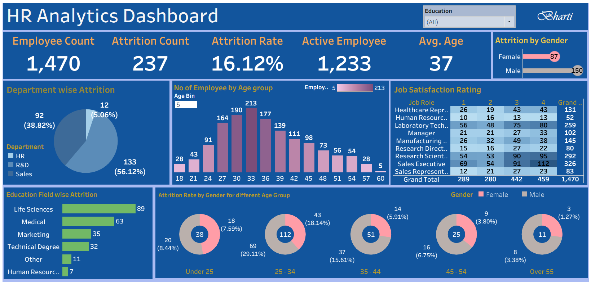

# HR Analytics Dashboard | Tableau

## Project Overview
An interactive HR Analytics Dashboard built using Tableau to analyze employee attrition, workforce demographics, department-wise trends, and job satisfaction.

## Tools Used
- Tableau Public
- Data Visualization
- HR Analytics

## Key Performance Indicators (KPIs)
- Total Employees: 1,470
- Attrition Count: 237
- Attrition Rate: 16.12%
- Active Employees: 1,233
- Average Employee Age: 37

## Dashboard Features
- Department-wise employee attrition
- Employee distribution by age group
- Attrition analysis by gender
- Education field-wise attrition
- Job satisfaction rating by job role
- Education filter for interactive analysis

## Files Included
- `HR Analytics Dashboard.twbx` — Tableau packaged workbook
- `Dashboard.png` — Dashboard screenshot

## Dashboard Preview

## Live Dashboard
[View the interactive dashboard on Tableau Public](https://public.tableau.com/views/HRDataAnalyticsDashboard_17922785518010/HRAnalyticsDashboard?:language=en-US&:sid=&:redirect=auth&:display_count=n&:origin=viz_share_link)

## Author
Bharti Kumari
